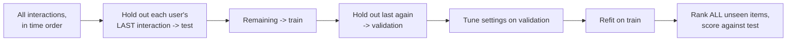

# recsys-engine

Three recommenders for implicit feedback (clicks, purchases, plays) written from scratch in NumPy, with an offline evaluation that avoids the usual ways of fooling yourself.

| Model | Idea |
|---|---|
| `Popularity` | Recommend what most people interacted with. The baseline. |
| `ItemKNN` | "People who interacted with this also interacted with that": cosine similarity between items, with shrinkage and top-k pruning. |
| `ALS` | Implicit-feedback matrix factorisation (Hu, Koren and Volinsky, 2008) solved by alternating least squares. |

## Results

`python -m recsys` on synthetic data: 800 users, 400 items, 19,921 interactions (6.2% of the matrix). Each user's last interaction is held out and the model ranks every item the user has not seen.

| Model | Hit rate@10 | NDCG@10 | MRR | Catalogue coverage@10 | Recommendations in a favoured genre |
|---|---:|---:|---:|---:|---:|
| Random | 0.024 | 0.011 | 0.007 | 100.0% | 0.15 |
| Popularity | 0.122 | 0.057 | 0.037 | 6.0% | 0.05 |
| Item kNN, 20 neighbours | 0.316 | 0.182 | 0.141 | 30.2% | 0.62 |
| ALS, 8 factors, alpha 5 | 0.321 | 0.189 | 0.148 | 38.8% | 0.69 |

What the table says:

- **Popularity is a real baseline**: five times better than chance, by recommending the same 24 items to everyone (6% coverage).
- **Both personalised models find the held-out item in the top 10 about 32% of the time**, 2.6 times as often as popularity, while recommending from a third of the catalogue.
- **ALS and item kNN are effectively tied** on accuracy. A difference of 0.005 on 800 users is well inside noise, so this run does not show one is better.
- **Popularity scores below random on genre match (0.05 vs 0.15).** That is not a bug. Recommendations exclude items already seen, and users have already consumed the popular items in the genres they like, so what is left of the popular list is mostly outside their taste.

**The data is synthetic.** Users are generated with one or two preferred genres, which gives the models something real to find and makes "favoured genre" measurable, but these numbers are not a claim about any real dataset.

## Evaluation choices



- **Leave-last-out, not a random split.** A random split trains on events that happened after the one being predicted. A test checks the held-out item is never visible in training.
- **Settings are tuned on a validation split, never on the test items.** An earlier version of the demo reported ALS at 32 factors and it lost to kNN. Tuning on validation picked 8 factors, which matches the 8 genres in the generator. Validation NDCG@10 across the grid ran from 0.101 (32 factors, alpha 20) to 0.185 (8 factors, alpha 5).
- **Every unseen item is ranked.** Scoring the target against a small random sample of negatives inflates metrics and can reorder models.
- **Coverage is reported next to accuracy**, because a model can score well by recommending the same few items to everyone.

## Implementation notes

- **ALS uses the standard trick to stay affordable.** For each user the system to solve is `(YᵀY + Yᵀ(C−I)Y + λI) x = YᵀC p`. `YᵀY` is computed once per sweep; the correction term only involves the items that user touched. A test asserts the loss decreases every iteration.
- **Cold start falls back to popularity** for unknown user ids and users with no history, and a test covers both.
- **kNN shrinkage** discounts similarities computed from very few shared users.
- A 6-user hand-built example is used to check kNN similarities and ALS recommendations against values worked out by hand.

```python
from recsys import generate, leave_last_out, ALS, ItemKNN, evaluate

data, _ = generate(seed=0)                    # or build Interactions(users, items, n_users, n_items)
train, held_out = leave_last_out(data)
model = ALS(factors=8, alpha=5).fit(train)
model.recommend(user=42, k=10)
evaluate(model, held_out, k=10, n_items=data.n_items)
```

```bash
pip install -e ".[dev]"
pytest -q          # 11 tests
python -m recsys
```

## Limits

- **Dense matrices.** The interaction matrix is a dense NumPy array, fine for hundreds of thousands of cells and not for millions of users. Real systems use sparse matrices and approximate nearest-neighbour search.
- **Offline metrics only.** Hit rate on held-out clicks is a proxy. Whether recommendations change behaviour needs an online experiment.
- **No side information, no recency weighting, no diversity re-ranking.**
- **One seed, one dataset.** No confidence intervals are reported, which is why the kNN/ALS gap is described as a tie.
